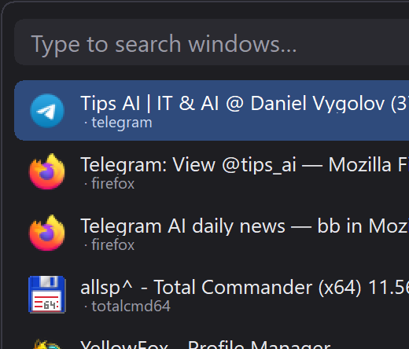

# Yet Another Switcher (YASwitcher)

A tiny, fast window switcher for Windows — an alternative to the heavyweight
Alt-Tab replacements. Written in Go against raw Win32, **no CGO**, **no third-party
dependencies**, a single ~2 MB executable.



## Why another switcher?

- **Lightweight.** One small `.exe`, no installer, no Electron/WebView, no .NET.
  Idle memory is a few megabytes and CPU stays at zero when not in use.
- **Instant.** The window list is built from the live desktop only when you open
  the switcher, so opening is a paint, not a scan.
- **Familiar.** Type to filter windows, `↑`/`↓` to move, `Enter` to switch,
  `Esc` to cancel — the same mental model as Switcheroo.
- **Multi-monitor aware.** The panel opens on the monitor under the cursor and
  shows which monitor it is.
- **Dark or light** theme, matching Windows' own look.

## Features

| Feature | Notes |
|---|---|
| Global hotkey | Default `Alt+Space`, configurable |
| Type-to-find | Prefix, substring and fuzzy (subsequence) matching |
| Up to 14 rows | Taller panel with a scrollbar; mouse wheel scrolls the list |
| Alt+Tab replacement | Optional — swallow `Alt+Tab`/`Shift+Tab`, release `Alt` to switch |
| Multi-monitor | Opens on the monitor under the cursor, shows "Monitor N" |
| Dark / light theme | Toggle from the tray menu |
| Autostart | Scheduled Task `Startup Admin - YASwitcher` (highest privileges, at logon) |
| Tray icon | Click to open, right-click for the menu |
| Single instance | A second launch does nothing (the first stays in the tray) |

## Usage

1. Run `yas-switcher.exe`. It appears in the notification area.
2. Press **Alt+Space** to open the switcher on the monitor under the cursor.
3. Type part of a window title or process name to filter.
4. `↑`/`↓` to choose, `Enter` to switch, `Esc` to cancel.
5. Right-click the tray icon to change the hotkey, theme, monitor indicator,
   Alt+Tab replacement and autostart, or to exit.

**About Alt+Space.** Windows reserves `Alt+Space` for the window menu, so a plain
`RegisterHotKey` cannot claim it. YASwitcher first tries the normal registration
and, if the system refuses, falls back to a low-level keyboard hook — the same
technique Switcheroo uses. Either way the shortcut works.

### Replacing the system Alt+Tab

Enable **Replace Alt+Tab** in the tray menu. The app installs a low-level
keyboard hook that swallows `Alt+Tab`/`Shift+Tab` while the panel is open and
commits the selection when you release `Alt`. This is opt-in because some users
prefer the native switcher.

## Configuration

Stored in `%APPDATA%\YASwitcher\config.json`:

```json
{
  "hotkey": "Alt+Space",
  "altTabMode": false,
  "autoStart": true,
  "autoUpdate": true,
  "darkTheme": true,
  "showMonitor": true,
  "maxResults": 40
}
```

## Build from source

Cross-compiling from Linux/WSL (as used in CI):

```sh
make build VERSION=1.0.0
# -> build/yas-switcher.exe
```

Requirements: Go 1.24+ and [`go-winres`](https://github.com/tc-hib/go-winres)
for embedding the icon and GUI manifest. The icon is generated by
`tools/genicon` (pure Go, no image tooling).

Local checks:

```sh
make test      # vet + build + gofmt check
```

## Releases

GitHub Actions builds on every push to `main` and publishes a Windows binary
on tags `v*`. The release workflow uploads `yas-switcher.exe`.

## License

MIT — see [LICENSE](LICENSE).
